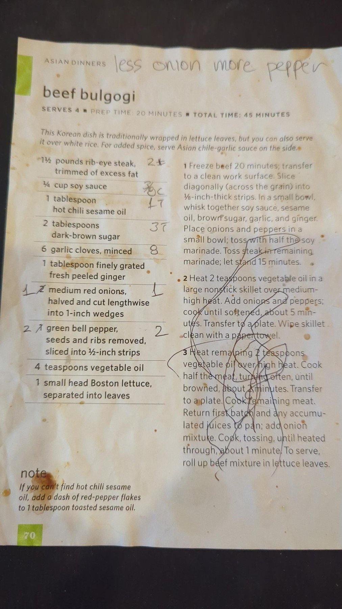

# Beef Bulgogi

*Thin-sliced rib-eye in a soy, brown sugar, garlic and ginger marinade, seared hot with onion and peppers and rolled in lettuce leaves or served over white rice. About 45 minutes.*

## Ingredients

- 900 g rib-eye steak (2 lb), trimmed of excess fat
- 100 g soy sauce (⅜ cup)
- 1 tbsp hot chili sesame oil
- 40 g dark-brown sugar (3 tbsp)
- 8 garlic cloves, minced
- 1 tbsp finely grated fresh peeled ginger
- 1 medium red onion (about 200 g), halved and cut lengthwise into 1-inch wedges
- 2 green bell peppers, seeds and ribs removed, sliced into ½-inch strips
- 4 tsp vegetable oil
- 1 small head Boston lettuce, separated into leaves

## Steps

1. **Firm up the beef.** Freeze the beef so it slices cleanly. *(timer: 20 min)*
2. **Slice.** Move the beef to a clean work surface and slice diagonally, across the grain, into ⅛-inch-thick strips.
3. **Marinate.** In a small bowl, whisk together the soy sauce, sesame oil, brown sugar, garlic and ginger. Put the onion and peppers in a small bowl and toss with half the marinade. Toss the steak with the remaining marinade and let stand. *(timer: 15 min)*
4. **Cook the vegetables.** Heat 2 tsp vegetable oil in a large nonstick skillet over medium-high heat. Add the onion and peppers and cook until softened. Transfer to a plate and wipe the skillet clean with a paper towel. *(timer: 5 min)*
5. **Sear the beef in batches.** Heat the remaining 2 tsp oil over high heat. Cook half the meat, turning often, until browned, then transfer to a plate. Cook the remaining meat the same way. Working in batches keeps the pan hot enough to brown instead of steam. *(timer: 2 min per batch)*
6. **Combine.** Return the first batch and any accumulated juices to the pan and add the onion mixture. Cook, tossing, until heated through. *(timer: 1 min)*
7. **Serve.** Roll up the beef mixture in lettuce leaves, or serve over white rice.

## Notes

From a clipped "Asian Dinners" page (p. 70). Changes from the printed version, per the handwritten notes on the page ("less onion more pepper" across the top):

- Rib-eye raised from 1½ lb to 2 lb.
- Soy sauce raised from ¼ cup to ⅜ cup, keeping the marinade in step with the extra beef.
- Brown sugar raised from 2 tbsp to 3 tbsp.
- Garlic raised from 6 cloves to 8.
- Red onions cut from 2 to 1.
- Green bell peppers raised from 1 to 2.

The hot chili sesame oil brings some heat. For a milder version, use plain toasted sesame oil. If you can't find hot chili sesame oil, the page suggests 1 tbsp toasted sesame oil with a dash of red-pepper flakes. For more spice, serve Asian chile-garlic sauce on the side.

The pen scribble over the steps doesn't change any words. It covers the first-batch time in step 5, which reads as "about 2 minutes" on the printed page.

## With the house bulgogi marinade

Use one batch of [Bulgogi Marinade](bulgogi-marinade.md) in place of the soy sauce, hot chili sesame oil, brown sugar, garlic and ginger. A batch is sized for 2 lb of beef. If there are no Asian pears, a ripe Comice works. This version has no chili, so it's mild.

1. **Make the marinade.** Set aside 60 g (¼ cup) for the vegetables before any beef goes in.
2. **Freeze and slice the beef** as in steps 1–2. *(timer: 20 min)*
3. **Marinate.** Toss the beef with the rest of the marinade and refrigerate. The pear needs hours to tenderize; past about 12 hours its enzymes make the beef mushy. Start around 2–3 pm for a 6 pm dinner. *(timer: 2–4 hr)*
4. **Cook.** Toss the onion and peppers with the reserved marinade, then follow steps 4–7. Let the extra marinade drip off the beef before it goes in the pan: the grated pear and onion scorch, and wet beef steams instead of browning.

## Original page

