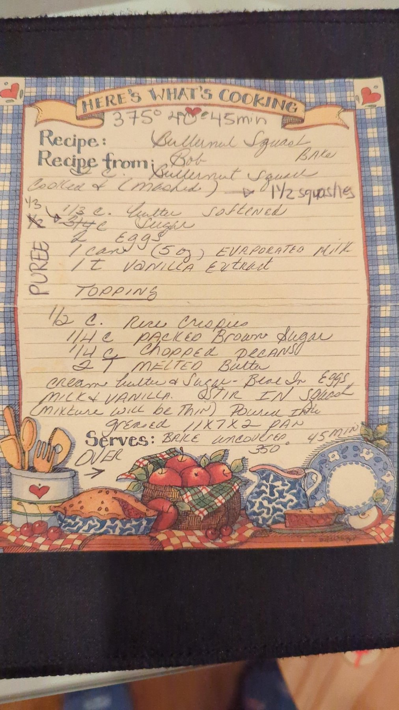
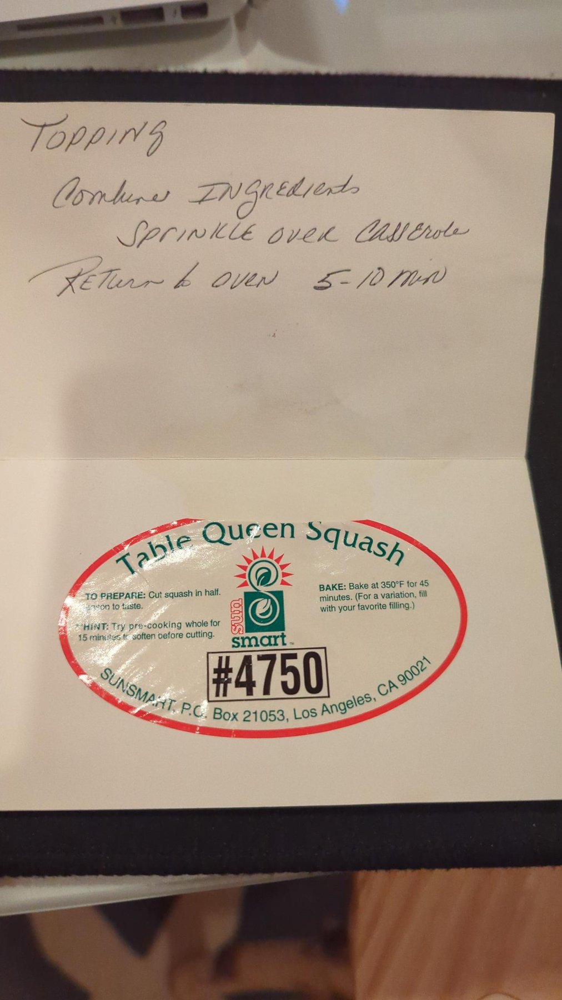

# Butternut Squash Bake

## Ingredients

**Casserole**

- 2 cups butternut squash, cooked & mashed (≈1½ squashes)
- ⅓ cup butter, softened
- ⅓ cup sugar
- 2 eggs
- 1 can (5 oz) evaporated milk
- 1 tsp vanilla extract

**Topping**

- ½ cup Rice Krispies
- ¼ cup packed brown sugar
- ¼ cup chopped pecans
- 2 tbsp melted butter

## Steps

1. **Cream butter & sugar.** Cream butter and sugar.
2. **Beat in wet ingredients.** Beat in eggs, evaporated milk and vanilla.
3. **Stir in squash.** Stir in butternut squash. (Mixture will be thin.)
4. **Pour into pan.** Pour into a greased 11x7x2 pan.
5. **Bake.** Bake uncovered at 375°F for 40–45 min (top-of-card note). Original instruction at bottom of card: 45 min at 350°F. *(timer: 45 min)*
6. **Make topping.** Combine Rice Krispies, packed brown sugar, chopped pecans and melted butter. Sprinkle over casserole.
7. **Finish baking.** Return to oven 5–10 min. *(timer: 10 min)*

## Notes

Sugar reflects the card's handwritten corrections: ¾ c → ½ c → ⅓ c.

"PUREE" is written alongside the filling ingredients.

Servings are left blank on the card.

## Original card

