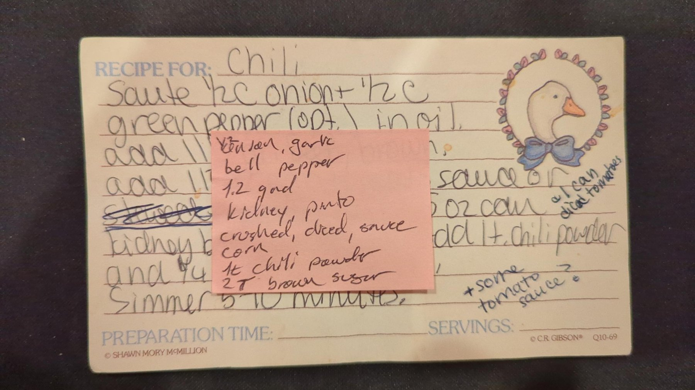
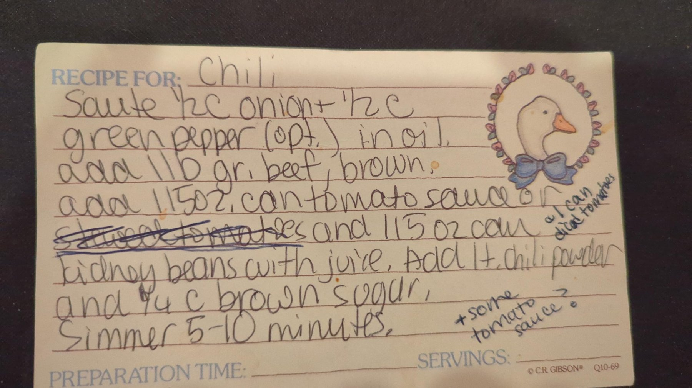

# Mary Ann's Chili

## Ingredients

- Oil, for sautéing
- 1 onion, chopped
- 3 garlic cloves, minced
- 1 bell pepper, chopped
- 1.2 lb ground beef
- 1 can kidney beans, with juice
- 1 can pinto beans
- 1 can crushed tomatoes
- 1 can diced tomatoes
- 1 can tomato sauce
- Frozen corn
- 1 tsp chili powder
- 2 tbsp brown sugar

## Steps

1. **Sauté the vegetables.** Sauté the onion, garlic and bell pepper in oil.
2. **Brown the beef.** Add the ground beef and brown it.
3. **Add the cans.** Add the crushed tomatoes, diced tomatoes, tomato sauce, kidney beans with their juice, pinto beans and frozen corn.
4. **Season and simmer.** Add the chili powder and brown sugar. Simmer 5–10 minutes. *(timer: 10 min)*

## Notes

Ingredients follow the pink sticky note on the card, which updates the original. Each bean and tomato item is one whole can. The note doesn't give amounts for the onion, garlic or bell pepper; the amounts here are how we make it. Add frozen corn to taste.

The card's original version: sauté ½ c onion and ½ c green pepper (optional) in oil; brown 1 lb ground beef; add one 15 oz can tomato sauce and one 15 oz can kidney beans with juice; add 1 tsp chili powder and ¼ c brown sugar; simmer 5–10 minutes. "Stewed tomatoes" is crossed out as an alternative to the tomato sauce.

Margin notes on the card add "1 can diced tomatoes" and "+ some tomato sauce?"; the sticky note folds both in.

## Original card

