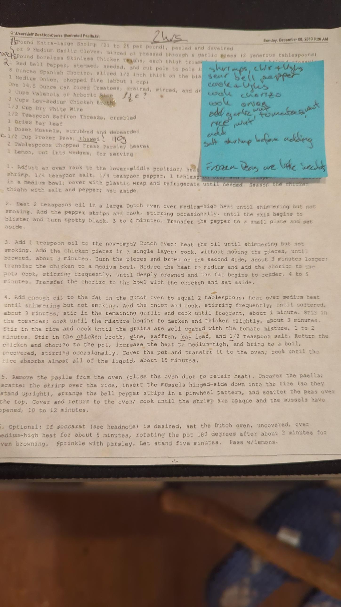

# Paella

*Dutch-oven paella with chicken, chorizo, shrimp and mussels. About 2 hours start to finish.*

## Ingredients

- 1½ lb extra-large shrimp (21–25 per pound), peeled and deveined
- 8 or 9 medium garlic cloves, minced or pressed (2 generous tablespoons)
- 1½ lb boneless skinless chicken thighs, trimmed and halved crosswise
- 2 red bell peppers, stemmed, seeded, cut pole to pole into ½-inch strips
- 8 oz Spanish chorizo, sliced ½ inch thick on the bias
- 1 medium onion, chopped fine (about 1 cup)
- One 14.5 oz can diced tomatoes, drained, minced, and drained again
- 300 g (1½ cups) Valencia or Arborio rice
- 3 cups low-sodium chicken broth
- ⅓ cup dry white wine
- ½ tsp saffron threads, crumbled
- 1 dried bay leaf
- 1 dozen mussels, scrubbed and debearded
- 110 g frozen peas, thawed
- 2 tbsp chopped fresh parsley leaves
- 1 lemon, cut into wedges, for serving

## Steps

1. **Season the shrimp and chicken.** Adjust an oven rack to the lower-middle position and heat the oven to 400°F. Toss the shrimp with ¼ tsp salt, ¼ tsp pepper, 1 tbsp oil, and 1 tsp of the garlic in a medium bowl; cover with plastic wrap and refrigerate until needed. Season the chicken thighs with salt and pepper and set aside.
2. **Blister the peppers.** Heat 2 tsp oil in a large Dutch oven over medium-high until shimmering but not smoking. Add the pepper strips and cook, stirring occasionally, until the skin begins to blister and turn spotty black. Transfer to a small plate and set aside. *(timer: 4 min)*
3. **Brown the chicken, then the chorizo.** Add 1 tsp oil to the empty Dutch oven and heat until shimmering. Add the chicken in a single layer and cook without moving until browned, about 3 minutes; turn and brown the second side about 3 minutes longer. Transfer to a medium bowl. Reduce the heat to medium, add the chorizo, and cook, stirring frequently, until deeply browned and the fat begins to render. Transfer the chorizo to the bowl with the chicken. *(timer: 11 min)*
4. **Build the sofrito and the rice.** Add enough oil to the fat in the pot to equal 2 tbsp and heat over medium until shimmering. Add the onion and cook, stirring frequently, until softened, about 3 minutes. Stir in the remaining garlic and cook until fragrant, about 1 minute. Stir in the tomatoes and cook until the mixture begins to darken and thicken slightly, about 3 minutes. Stir in the rice and cook until the grains are well coated, 1 to 2 minutes. Stir in the broth, wine, saffron, bay leaf, and ½ tsp salt. Return the chicken and chorizo to the pot, raise the heat to medium-high, and bring to a boil uncovered, stirring occasionally. *(timer: 10 min)*
5. **Bake.** Cover the pot and transfer it to the oven. Cook until the rice absorbs almost all of the liquid. Start checking early — with 300 g of rice against the full 3 cups of broth, the liquid can go sooner than the clock suggests. *(timer: 15 min)*
6. **Add the shellfish and peas.** Remove the paella from the oven, closing the oven door to retain heat. Uncover; scatter the shrimp over the rice, insert the mussels hinged-side down so they stand upright, arrange the pepper strips in a pinwheel, and scatter the peas over the top. Salt the shrimp as they go in. Cover and return to the oven until the shrimp are opaque and the mussels have opened. *(timer: 11 min)*
7. **Socarrat (optional).** For a crisp browned crust on the bottom, set the uncovered Dutch oven over medium-high heat for about 5 minutes, rotating the pot 180 degrees after about 2 minutes for even browning. *(timer: 5 min)*
8. **Rest and serve.** Sprinkle with parsley and let stand 5 minutes. Pass lemon wedges at the table. *(timer: 5 min)*

## Notes

Total time runs about 2 hours.

Salt the shrimp again as they go into the pot in step 6 — easy to skip, since they were seasoned back in step 1 and it's tempting to assume that's enough.

**Rice.** The printed recipe called for 2 cups; this version uses 1½ cups (300 g). With the broth and wine unchanged, that's a wetter ratio, so expect a softer, more absorbent result and watch the pot rather than the timer in step 5.

**Peas.** 110 g replaces the printed ½ cup — roughly ¾ of a cup. For a full cup, go to about 140 g.

**Scaled up from the printed amounts.** Shrimp and chicken thighs both to 1½ lb, bell pepper to 2. "More" is written beside the garlic, so lean toward 9 cloves or beyond.

**Obscured on the original.** A sticky note covers part of the first step and the ends of two ingredient lines. The bell-pepper cut and the chicken-thigh trim are reconstructed from the standard version of this recipe.

## Order of operations

From the sticky note on the card:

1. Shrimp, chicken + thighs
2. Sear bell pepper
3. Cook thighs
4. Cook chorizo
5. Cook onion
6. Add garlic, wait — tomatoes, wait
7. Rice, wait
8. Add shellfish; salt shrimp before adding

## Original card

