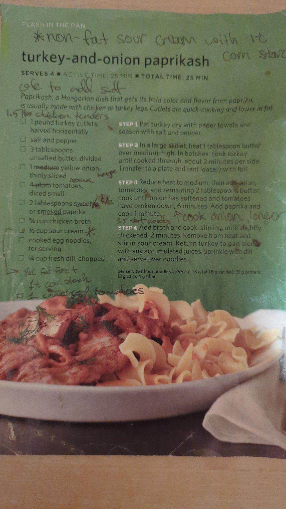

# Paprikash

*Quick skillet paprikash with chicken tenders, a soft onion-tomato base and a light sour cream sauce, served over egg noodles. About 30 minutes.*

## Ingredients

- 1.5 lb chicken tenders
- Salt and pepper
- 3 tbsp unsalted butter, divided
- 1 large yellow onion, thinly sliced
- 4 Roma tomatoes, diced small
- 1 can diced tomatoes
- 2 tbsp paprika, half sweet and half smoked
- ¾ cup chicken broth
- ½ cup fat-free sour cream
- 1 tsp cornstarch
- Cooked egg noodles, for serving
- ¼ cup fresh dill, chopped

## Steps

1. **Season the chicken.** Pat the chicken dry with paper towels and season with salt and pepper.
2. **Cook the chicken.** Heat 1 tbsp of the butter in a large skillet over medium-high heat. Cook the chicken in batches until cooked through, about 2 minutes per side. Move to a plate and tent loosely with foil. *(timer: 4 min)*
3. **Cook the onion and tomatoes.** Lower the heat to medium and add the onion, tomatoes and the remaining 2 tbsp butter. Cook until the onion is soft and the tomatoes have broken down. Give the onion longer than you think. Stir in the paprika and cook 1 minute. *(timer: 10 min)*
4. **Start the noodles.** Put the egg noodles on to cook now so they're ready with the sauce.
5. **Finish the sauce.** Stir the cornstarch into the sour cream. Add the broth to the skillet and cook, stirring, until slightly thickened. *(timer: 2 min)*
6. **Serve.** Take the pan off the heat and stir in the sour cream. Return the chicken and any juices to the pan. Sprinkle with dill and serve over the noodles.

## Notes

From Martha Stewart's "Turkey-and-Onion Paprikash" (a clipped "Flash in the Pan" page), with Jeff's changes written on it:

- 1.5 lb chicken tenders instead of 1 lb turkey cutlets, halved horizontally.
- A large onion instead of a medium one, and cook it longer than the page's 6 minutes.
- 4 Roma tomatoes instead of 4 plum tomatoes, plus a can of diced tomatoes.
- Paprika: 2 tbsp, half sweet and half smoked, where the page says sweet or smoked.
- ½ cup fat-free sour cream with 1 tsp cornstarch instead of ⅓ cup regular sour cream. The cornstarch keeps fat-free sour cream from breaking in the hot sauce.
- "OK to add salt": the butter is unsalted, so season to taste at the end.

## Original page

