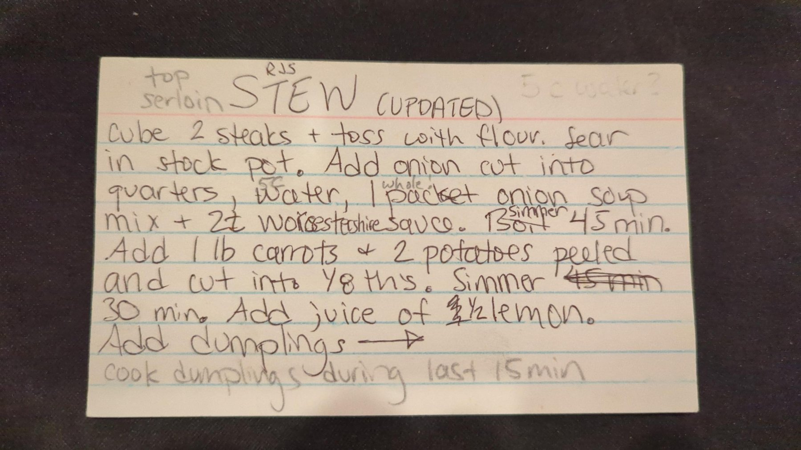
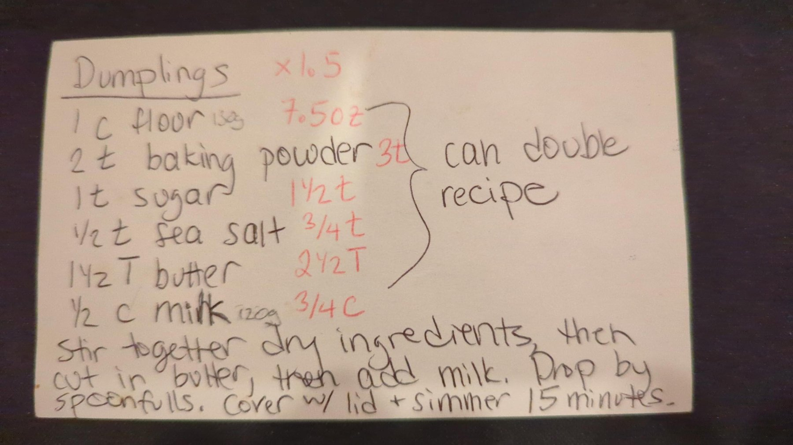

# RJS Stew with Dumplings

## Ingredients

**Stew**

- 2 top sirloin steaks, cubed
- Flour, for tossing
- 1 onion, cut into quarters
- 5 cups water
- 1 whole packet onion soup mix
- 2 tsp Worcestershire sauce
- 1 lb carrots, peeled and cut into eighths
- 2 potatoes, peeled and cut into eighths
- Juice of ½ lemon

**Dumplings (1½ batch, per the card)**

- 7.5 oz flour
- 3 tsp baking powder
- 1½ tsp sugar
- ¾ tsp sea salt
- 2½ tbsp butter
- ¾ cup milk

## Steps

1. **Sear the beef.** Cube the steaks and toss with flour. Sear in a stock pot.
2. **Simmer the base.** Add the quartered onion, water, onion soup mix and Worcestershire sauce. Simmer 45 min. *(timer: 45 min)*
3. **Add the vegetables.** Add the carrots and potatoes. Simmer 30 min total; the dumplings go in for the last 15. *(timer: 15 min)*
4. **Make the dumpling dough.** While the vegetables simmer, stir together the flour, baking powder, sugar and salt. Cut in the butter, then add the milk.
5. **Lemon and dumplings.** Add the lemon juice. Drop the dough by spoonfuls onto the stew, cover with the lid and simmer 15 minutes. *(timer: 15 min)*

## Notes

The card is titled "Stew (Updated)." These are the card's corrected values: the first simmer changed from "boil" to "simmer," the vegetable simmer from 45 to 30 min, and the lemon to ½.

Water: "5c" is written in above "water," and a pencil note at the top of the card says "5 c water?", so the amount may still be unsettled.

Dumpling amounts are the card's red 1½× column. Original single batch: 1 c flour (135 g), 2 tsp baking powder, 1 tsp sugar, ½ tsp sea salt, 1½ tbsp butter, ½ c milk (120 g). The card notes the recipe can be doubled. The red butter amount reads 2½ tbsp; a straight 1½× would be 2¼.

The pencil note "cook dumplings during last 15 min" sets the timing in steps 3–5.

## Original card

