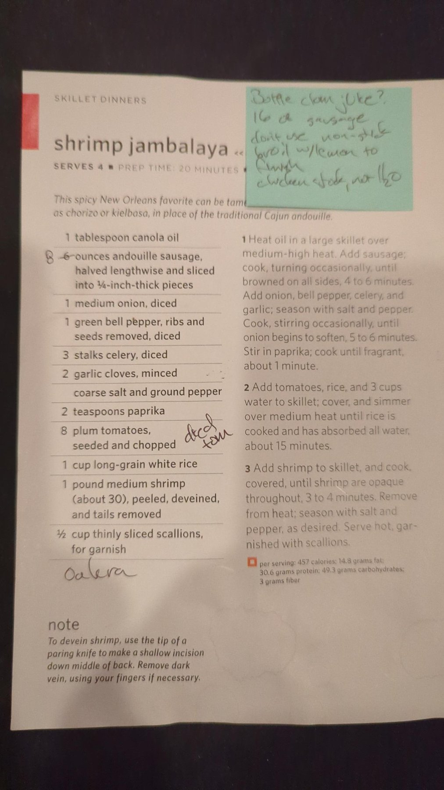

# Shrimp Jambalaya

## Ingredients

- 1 tbsp canola oil
- 16 oz andouille sausage, halved lengthwise and sliced ¼ inch thick
- 1 medium onion, diced
- 1 green bell pepper, ribs and seeds removed, diced
- 3 celery stalks, diced
- 2 garlic cloves, minced
- Coarse salt and ground pepper
- 2 tsp paprika
- 1 can (15 oz) diced tomatoes
- 1 cup long-grain white rice
- 1 bottle (8 oz) clam juice
- 2 cups chicken stock
- 1 lb medium shrimp (about 30), peeled, deveined, tails removed
- 1 lemon
- ½ cup thinly sliced scallions, for garnish

## Steps

1. **Brown the sausage.** Heat the oil in a large oven-safe skillet over medium-high heat. Don't use non-stick, since the skillet goes under the broiler. Add the sausage and cook, turning now and then, until browned on all sides. *(timer: 5 min)*
2. **Cook the vegetables.** Add the onion, bell pepper, celery and garlic, and season with salt and pepper. Cook, stirring occasionally, until the onion starts to soften. Stir in the paprika and cook until fragrant, about 1 minute. *(timer: 6 min)*
3. **Simmer the rice.** Add the tomatoes with their juice, the rice, clam juice and chicken stock. Cover and simmer over medium heat until the rice is cooked and has absorbed the liquid. *(timer: 15 min)*
4. **Cook the shrimp.** Add the shrimp, cover, and cook until opaque throughout. *(timer: 3 min 30 sec)*
5. **Broil to finish.** Move the skillet under the broiler until the top browns, watching closely. *(timer: 3 min)*
6. **Serve.** Squeeze lemon over the top, season with salt and pepper to taste, and garnish with scallions.

## Notes

From a clipped recipe page ("Skillet Dinners"), source unknown. Changes from the printed version, per Jeff's notes on the page:

- Sausage raised from 6 oz to 16 oz (an earlier margin note says 8).
- One 15 oz can of diced tomatoes instead of 8 fresh plum tomatoes, seeded and chopped.
- Clam juice and chicken stock instead of 3 cups water. The split here (one bottle plus 2 cups stock) keeps the original 3 cups of liquid.
- Broiled with lemon to finish, so use an oven-safe skillet, not non-stick.

Andouille brings some heat. For a milder pot, the page suggests kielbasa or chorizo instead.

Untested idea: "okra" is written under the ingredient list.

## Kielbasa version

A milder version with sweet paprika and Stamboom kielbasa instead of andouille. Serves 4.

**Ingredients**

- 1 tbsp canola oil
- 16 oz Stamboom kielbasa, halved lengthwise and sliced ¼ inch thick
- 1 medium onion, diced
- 1 green bell pepper, ribs and seeds removed, diced
- 3 celery stalks, diced
- 2 garlic cloves, minced
- Coarse salt and ground pepper
- 2 tsp sweet paprika (not smoked or hot)
- 1 can (15 oz) diced tomatoes
- 1 cup long-grain white rice
- 1 bottle (8 oz) clam juice
- 2 cups chicken stock
- 1 lb medium shrimp, peeled, deveined, tails removed
- 1 lemon
- ½ cup thinly sliced scallions

**Steps**

1. **Brown the sausage.** Heat the oil in a large oven-safe (not non-stick) skillet over medium-high heat. Brown the kielbasa on all sides. It's milder than andouille, so brown it a bit longer to build the browned bits in the pan. *(timer: 7 min)*
2. **Cook the vegetables.** Add the onion, bell pepper, celery and garlic, and season with salt and pepper. Cook until the onion starts to soften, then stir in the paprika for 1 minute. *(timer: 6 min)*
3. **Simmer the rice.** Add the tomatoes with their juice, the rice, clam juice and stock. Cover and simmer over medium heat until the rice is cooked and the liquid is absorbed. *(timer: 15 min)*
4. **Cook the shrimp.** Add the shrimp, cover, and cook until opaque. *(timer: 3 min 30 sec)*
5. **Broil to finish.** Put the skillet under the broiler until the top browns, watching closely. *(timer: 3 min)*
6. **Serve.** Squeeze lemon over the top, adjust salt and pepper, and garnish with scallions.

To skip the shrimp, use 20–24 oz kielbasa and swap the clam juice for 1 more cup of stock.

## Original page

