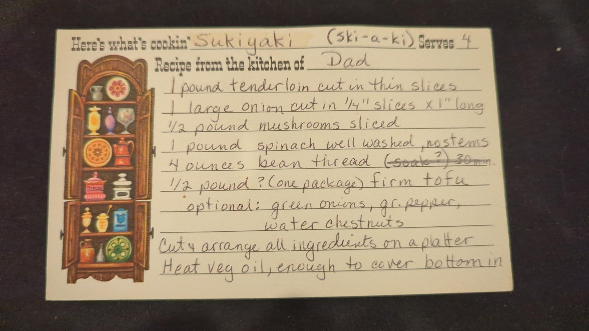
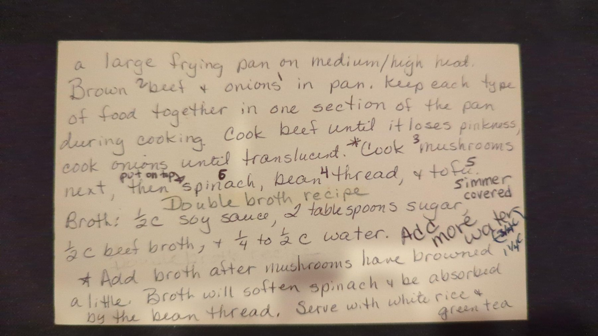

# Sukiyaki (ski-a-ki)

## Ingredients

**Platter**

- 1 lb beef tenderloin, cut in thin slices
- 1 large onion, cut in ¼" slices x 1" long
- ½ lb mushrooms, sliced
- 1 lb spinach, well washed, no stems
- 4 oz bean thread
- ½ lb firm tofu (one package)

**Broth (doubled, per the card)**

- 1 cup soy sauce
- 4 tbsp sugar
- 1 cup beef broth
- ½ cup water (½–1 c), plus more as needed

## Steps

1. **Prep platter.** Cut and arrange all ingredients on a platter.
2. **Mix broth.** Combine soy sauce, sugar, beef broth and water. Add more water as needed.
3. **Heat oil.** Heat vegetable oil, enough to cover the bottom, in a large frying pan on medium/high heat.
4. **Onions, then beef.** Brown onion first, then beef. Keep each type of food together in one section of the pan during cooking. Cook onions until translucent and beef until it loses pinkness.
5. **Mushrooms & broth.** Cook mushrooms next. Add the broth after the mushrooms have browned a little.
6. **Bean thread, tofu, spinach.** Add bean thread, then firm tofu, then put spinach on top. Simmer covered. The broth will soften the spinach and be absorbed by the bean thread.
7. **Serve.** Serve with white rice and green tea.

## Notes

Optional: green onions, green pepper, water chestnuts.

Cooking order follows the numbers written on the card (onions, beef, mushrooms, bean thread, tofu, spinach on top).

Broth amounts are doubled per the card's "Double broth recipe" note. Original single batch: ½ c soy sauce, 2 tbsp sugar, ½ c beef broth, ¼–½ c water.

The card's "(soak?) 30 min" note next to the bean thread is crossed out, so it's left off here.

There's an unclear scribble next to "Add more water" that may say "1¼ c."

## Original card

